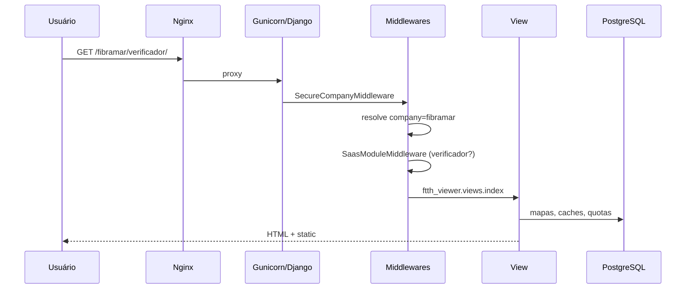

# Documentação técnica — RM Systems

**Versão:** maio/2026 · **Stack:** Django 5.2 · **Repositório:** `Saas-Verificador-de-Viabilidade`

Este documento descreve o sistema **como implementado no código**. Para início rápido, veja também [README.md](../README.md) e [PLATAFORMA-UNIFICADA.md](PLATAFORMA-UNIFICADA.md).

---

## Índice

1. [Visão geral](#1-visão-geral)
2. [Arquitetura do sistema](#2-arquitetura-do-sistema)
3. [Estrutura de módulos e código](#3-estrutura-de-módulos-e-código)
4. [Funcionalidades e regras de negócio](#4-funcionalidades-e-regras-de-negócio)
5. [Autenticação, permissões e multi-tenant](#5-autenticação-permissões-e-multi-tenant)
6. [Frontend (templates e estáticos)](#6-frontend-templates-e-estáticos)
7. [Backend (views, serviços, middlewares)](#7-backend-views-serviços-middlewares)
8. [APIs e endpoints](#8-apis-e-endpoints)
9. [Banco de dados](#9-banco-de-dados)
10. [Integrações externas](#10-integrações-externas)
11. [Workers e serviços auxiliares](#11-workers-e-serviços-auxiliares)
12. [DevOps, deploy e monitoramento](#12-devops-deploy-e-monitoramento)
13. [Variáveis de ambiente](#13-variáveis-de-ambiente)
14. [Testes](#14-testes)
15. [Melhorias e débito técnico](#15-melhorias-e-débito-técnico)

---

## 1. Visão geral

### 1.1 O que é

**RM Systems** é um SaaS B2B para **provedores de internet (ISPs)**. Cada cliente é uma **empresa** identificada por `slug` na URL (`https://dominio.com/fibramar/...`).

### 1.2 Objetivo técnico

- Monólito Django com **isolamento lógico por tenant** (não é schema-per-tenant; é `company_id` + middleware)
- Três **módulos opcionais** por empresa: `verificador`, `alertas`, `olt`
- **Planos comerciais** com limites numéricos (`core/plans.py` + `core/quotas.py`)
- **LGPD** operacional (consentimento, exportação, exclusão, retenção)
- **Hardening** OWASP/LGPD (MFA, CSP, mídia autenticada, rate limit)

### 1.3 Apps Django

| App | Responsabilidade |
|-----|------------------|
| `core` | Tenant, usuários, mapas CTO, tickets, LGPD, billing, DRF, middlewares |
| `ftth_viewer` | UI/API do verificador (mapa, geocode, viabilidade) |
| `alerts` | Config alertas, linhas WhatsApp, API para worker |
| `olt_ops` | OLTs, VPN, jobs CLI |
| `saas_viabilidade` | Projeto (settings, urls, security bootstrap) |

---

## 2. Arquitetura do sistema

### 2.1 Padrão arquitetural

**Monólito modular** em camadas:

```
Requisição HTTP
    → Middlewares (segurança, tenant, módulo, consent, MFA)
    → View (core / ftth_viewer / alerts / olt_ops)
    → Models + serviços (quotas, e-mail, billing, queue OLT)
    → PostgreSQL / Redis / filesystem (media, Mapas/)
    → Resposta HTML ou JSON
```

Não há microsserviços para o core web. Workers **fora do processo Django**:

- **Alert Bridge** (Node) — polling da API interna
- **OLT Worker** (Docker) — execução isolada de jobs SSH quando `OLT_EXECUTION_MODE=container`

### 2.2 Fluxo de uma requisição (empresa)



### 2.3 Comunicação “frontend / backend”

O frontend **não é SPA separado**. O Django renderiza templates; JavaScript chama endpoints JSON no **mesmo domínio** (sessão + CSRF cookie).

| Tipo | Exemplo |
|------|---------|
| Páginas HTML | `templates/company/tickets/detail.html` |
| AJAX / polling | `ticket-detail.js` → `/{slug}/tickets/{id}/mensagens/` |
| API FTTH | `/{slug}/verificador/api/verificar-viabilidade` |
| API DRF | `/api/v1/companies/` (sessão autenticada) |
| API interna | `/api/internal/alert-bridge/configs/` (token + HMAC) |

### 2.4 Roteamento global (`saas_viabilidade/urls.py`)

| Prefixo | Destino |
|---------|---------|
| `/health/`, `/ready/` | Health checks |
| `/api/v1/` | DRF |
| `/api/internal/alert-bridge/configs/` | Worker alertas |
| `/api/webhooks/asaas/` | Billing |
| `/rm/` | Painel RM |
| `/verificador/` | FTTH global (legado) |
| `/{company_slug}/` | Tenant (`core.urls_company`) |
| `/media/` | Mídia protegida (autenticada) |
| `/*` | `force_404` (catch-all) |

---

## 3. Estrutura de módulos e código

### 3.1 `core/` — núcleo da plataforma

| Arquivo / pasta | Responsabilidade |
|-----------------|------------------|
| `models.py` | `Company`, `CustomUser`, `CTOMapFile`, tickets, LGPD, billing |
| `views.py` | Login RM/empresa, dashboards, mapas, usuários |
| `ticket_views.py` | Tickets e mensagens (AJAX) |
| `lgpd_views.py` | Portal do titular, export, exclusão |
| `permissions.py` | Decorators e DRF permissions |
| `plans.py` / `quotas.py` | Planos P/M/G/XL e enforcement |
| `middleware_*.py` | Tenant, MFA, consent, rate limit, sessão |
| `media_protected.py` | Serve `/media/` só autenticado |
| `api.py` / `api_urls.py` | ViewSets DRF |
| `billing/asaas_webhook.py` | Webhook pagamentos |
| `email/` | Backend Resend, templates transacionais |
| `management/commands/` | Operação (LGPD, segurança, e-mail teste) |

### 3.2 `ftth_viewer/`

| Componente | Função |
|------------|--------|
| `views.py` | `index`, APIs geocode/CEP/viabilidade, cache |
| `utils.py` | Roteamento OSRM/ORS, distâncias, parsing mapas |
| `models.py` | `GeocodingCache`, `ViabilidadeCache` |
| `urls.py` | Rotas sob `verificador/` |
| `static/ftth_viewer/js/app.js` | Mapa Leaflet, busca, viabilidade |

### 3.3 `alerts/`

| Componente | Função |
|------------|--------|
| `models.py` | `AlertBridgeConfig`, `WhatsAppLine`, `AlertBridgeWorkerStatus` |
| `views.py` | Painel config, QR WhatsApp, `worker_configs_api` |
| `whatsapp_client.py` | HTTP para bridge Node (`WHATSAPP_BRIDGE_URL`) |

### 3.4 `olt_ops/`

| Componente | Função |
|------------|--------|
| `models.py` | `OltEquipment`, `CompanyVpnConfig`, `OnuCleanupJob` |
| `views.py` | CRUD OLT, jobs, log ao vivo |
| `queue.py` / `dispatcher.py` | Fila e execução de jobs |
| `huawei_cli.py`, `zte_cli.py`, `olt_service.py` | Sessões SSH CLI |
| `gpon_parse.py` | Parser de saída `display ont` |

### 3.5 `saas_viabilidade/`

| Arquivo | Função |
|---------|--------|
| `settings.py` | Config central (DB, cache, LGPD, OLT, DRF) |
| `security_bootstrap.py` | Falha boot se DEBUG/SECRET_KEY/mídia insegura em prod |
| `env_loader.py` | Carrega `.env` + `.env.local` |
| `sentry_bootstrap.py` | Sentry sem PII |
| `management/commands/runserver.py` | Dev: opcionalmente sobe alert bridge |

---

## 4. Funcionalidades e regras de negócio

### 4.1 Módulo Verificador FTTH

**Entrada:** mapas CTO (`.xlsx`, `.xls`, `.csv`, `.kml`, `.kmz`) via `/{slug}/upload/`.

**Processamento:**

1. Arquivo salvo em `CTOMapFile` (empresa, metadados, JSON de análise)
2. Usuário abre `/{slug}/verificador/` — mapa carrega pontos do backend
3. Busca endereço → `api/geocode` (Nominatim + cache `GeocodingCache` com hash, sem endereço completo persistido)
4. `api/verificar-viabilidade` calcula distância ao CTO mais próximo (OSRM ou OpenRouteService)
5. Classificação por `VIABILIDADE_VIABLE`, `VIABILIDADE_LIMITADA`, `VIABILIDADE_INVIAVEL` (metros)

**Quotas:** `max_maps`, `max_viability_month` por plano.

**Regra:** `COMPANY_USER` pode usar verificador; upload depende de `can_upload_maps`.

### 4.2 Módulo Alertas

**Fluxo:**

1. Admin empresa configura `AlertBridgeConfig` (token Telegram criptografado, filtros)
2. Cadastra `WhatsAppLine`(s) — pareamento QR via bridge Node
3. Worker `services/alert_bridge` faz poll em `/api/internal/alert-bridge/configs/`
4. Mensagens Telegram filtradas → encaminhadas ao WhatsApp

**Quotas:** chips, números de alerta, mensagens/mês (planos G/XL).

**Permissão:** `company_module_admin_required('alertas')` — só `COMPANY_ADMIN` ou RM.

### 4.3 Módulo OLT / ONU

**Fluxo:**

1. Configurar `CompanyVpnConfig` (OpenVPN/L2TP)
2. Cadastrar `OltEquipment` (host, credenciais criptografadas, vendor Huawei/ZTE)
3. Criar `OnuCleanupJob` → listar ONUs offline → executar exclusão
4. Execução: thread no Gunicorn (`host`) ou container (`container`)

**Quotas:** `max_olts`, `max_olt_jobs_month` (plano XL).

### 4.4 Tickets de suporte

| Entidade | Campos relevantes |
|----------|-------------------|
| `Ticket` | `company`, `created_by`, `subject`, `status`, `priority` |
| `TicketMessage` | `ticket`, `sender`, `message`, `is_internal` (só RM) |
| `TicketNotification` | Notificações não lidas |

**Regras:**

- Empresa abre ticket → e-mail ao criador + equipe RM (`send_ticket_created_email` em background)
- Chat com polling AJAX (`ticket-detail.js`, intervalo ~2s)
- RM vê todos os tickets; empresa só os próprios

### 4.5 LGPD

| Funcionalidade | Implementação |
|----------------|---------------|
| Consentimento | `ConsentRecord` + `ConsentMiddleware` |
| Portal titular | `/meus-dados/`, export JSON/CSV/ZIP assinado |
| Exclusão | `DataSubjectRequest` + comando `process_data_subject_requests` |
| Retenção | `purge_lgpd_retention`, dias configuráveis por tipo |
| DPO | `/encarregado-dados/` |

### 4.6 Billing (Asaas)

- `CompanyBilling` — status `trial|active|past_due|suspended|cancelled`
- Webhook `POST /api/webhooks/asaas/` atualiza status e `company.is_active`
- Planos definidos em código; cobrança integrada, **sem** Stripe

### 4.7 Planos (`core/plans.py`)

```python
# Exemplo — plano XL
PlanLimits(
    code="XL",
    monthly_price_brl=1497,
    max_users=40,
    max_maps=200,
    max_viability_month=25000,
    modules=frozenset({"verificador", "alertas", "olt"}),
    ...
)
```

`apply_plan_modules(company, plan_code)` sincroniza flags `module_*`.

`core/quotas.py`:

- `resolve_limits(company)` — plano + overrides RM
- `enforce_quota(company, metric)` — bloqueia ação se excedido
- `get_usage_summary(company)` — exibido no painel (`quota_usage.html`)

---

## 5. Autenticação, permissões e multi-tenant

### 5.1 Modelo de usuário (`CustomUser`)

| Campo | Descrição |
|-------|-----------|
| `role` | `RM`, `COMPANY_ADMIN`, `COMPANY_USER` |
| `company` | FK — obrigatório exceto RM |
| `must_change_password` | Redireciona para `/change-password-required/` |

**Properties:** `is_rm_admin`, `is_company_admin`, `can_manage_users`, `can_upload_maps`.

### 5.2 Fluxos de login

| Fluxo | View | URL |
|-------|------|-----|
| RM | `rm_login_view` | `/rm/login/` |
| Empresa | `company_login_view` | `/{slug}/login/` |
| Pós-login | `dashboard_redirect` | `/dashboard/` |
| Hub módulos | `company_hub` | `/{slug}/hub/` |
| Ativação | `account_activate` | `/ativar-conta/{token}/` |

`core/modules.py` — `post_login_redirect_url`: se um módulo só, vai direto; senão hub.

### 5.3 MFA (`django_otp`)

- Views: `mfa_setup`, `mfa_verify`, `mfa_recovery`, `mfa_trusted_devices`
- `MfaEnforcementMiddleware` — redireciona se `MFA_REQUIRED` e sem TOTP verificado
- `TrustedDevice` — “lembrar dispositivo” (`MFA_REMEMBER_DAYS`)

### 5.4 Middlewares (ordem)

| Middleware | Efeito |
|------------|--------|
| `SecureCompanyMiddleware` | `request.company` pelo slug; **logout** se usuário de outro tenant |
| `SaasModuleMiddleware` | 403 se módulo desabilitado na URL |
| `ConsentMiddleware` | Redireciona se versão legal não aceita |
| `PasswordChangeMiddleware` | Força troca de senha |
| `SessionIdleTimeoutMiddleware` | Expira sessão inativa |
| `GlobalRateLimitMiddleware` | Rate limit global (Redis) |
| `SecurityHeadersMiddleware` | CSP, HSTS, etc. |

### 5.5 Decorators (`core/permissions.py`)

```python
@company_access_required(require_admin=True)
def company_user_list(request, company_slug): ...

@company_module_required('alertas')
def alert_settings(request, company_slug): ...

@rm_admin_required
def rm_admin_dashboard(request): ...
```

**DRF:** `TenantScopedPermission` — filtra queryset por `company_id`; RM vê tudo.

---

## 6. Frontend (templates e estáticos)

### 6.1 Organização de templates

| Pasta | Conteúdo |
|-------|----------|
| `templates/base.html` | Layout principal, sidebar, CSP nonce |
| `templates/rm/` | Painel operador |
| `templates/company/` | Painel cliente |
| `templates/core/` | MFA, LGPD, e-mails HTML |
| `templates/ftth_viewer/` | App mapa (também em app) |
| `templates/alerts/`, `olt_ops/` | Módulos |
| `templates/legal/`, `docs/` | Páginas públicas |
| `templates/includes/` | `saas_sidebar_modules.html`, `quota_usage.html` |

**Nota:** existe duplicata `core/templates/core/` (dashboards legados no app).

### 6.2 JavaScript principal

| Arquivo | Uso |
|---------|-----|
| `global-loading.js` | Overlay loading; ignora tickets/mensagens |
| `ticket-detail.js` | Chat tickets (POST JSON, polling) |
| `upload-page.js` | Upload mapas com progresso |
| `login.js` / `auth-forms.js` | Login e validação |
| `dark-mode.js` | Tema claro/escuro |
| `sidebar-nav.js` | Navegação módulos |
| `olt-live.js` | Log ao vivo jobs OLT |
| `static/ftth_viewer/js/app.js` | Mapa FTTH |

**Não há React hooks** — padrão IIFE / event listeners + `fetch` com CSRF token.

### 6.3 CSS

| Arquivo | Escopo |
|---------|--------|
| `design-system.css` | Tokens, tipografia, cores |
| `platform.css` | Layout SaaS |
| `theme_rm.css` | Variante RM |
| `tickets-page.css`, `upload-page.css`, … | Páginas específicas |
| `app-responsive.css` | Breakpoints mobile |

### 6.4 UX implementada

- Hub de módulos quando mais de um contratado
- Indicador de quotas (`company_quotas` context processor)
- Toasts (`toast.js`)
- PWA parcial: `manifest.json`, `sw.js`
- Chat tickets otimista + anti-duplicata (`dom-safe.js`)
- Responsivo: `auth_mobile_scroll_fix.html`, CSS mobile FTTH

---

## 7. Backend (views, serviços, middlewares)

### 7.1 Views principais (`core/views.py`)

Funções de alto volume: autenticação, `company_dashboard`, upload mapas (`company_map_upload`), gestão usuários, relatórios, redirecionamentos legais.

### 7.2 Serviços transversais

| Módulo | Função |
|--------|--------|
| `core/utils.py` | `run_in_background`, e-mails ticket, helpers |
| `core/email/send_transactional.py` | Envio Resend unificado |
| `core/bridge_security.py` | HMAC + nonce API bridge |
| `core/encrypted_fields.py` | `EncryptedCharField` (Fernet) |
| `core/cnpj_utils.py` | Formato, hash, máscara CNPJ |
| `ftth_viewer/utils.py` | Roteamento e distância |
| `olt_ops/queue.py` | Enfileirar jobs OLT |

### 7.3 Validações importantes

- Upload mapas: extensão, tamanho, conteúdo (`core` validators)
- Senha: Argon2, mínimo 14 caracteres (`AUTH_PASSWORD_VALIDATORS`)
- Boot produção: `security_bootstrap.py` bloqueia config insegura

---

## 8. APIs e endpoints

### 8.1 REST API (`/api/v1/`)

| Recurso | ViewSet | Métodos |
|---------|---------|---------|
| `companies` | `CompanyViewSet` | CRUD + `stats`, `users` |
| `maps` | `CTOMapFileViewSet` | CRUD + `by_company`, `recent`, `stats` |
| `users` | `UserViewSet` | CRUD |

**Auth:** `SessionAuthentication` — uso típico: integrações internas no browser logado ou scripts com sessão.

**Documentação:** `/api/v1/docs/` (Swagger UI).

**Exemplo (curl com sessão):**

```bash
curl -b cookies.txt https://rmsys.app/api/v1/companies/ \
  -H "Accept: application/json"
```

### 8.2 API FTTH (JSON, mesmo app)

Base: `/{company_slug}/verificador/api/`

| Endpoint | Método | Função |
|----------|--------|--------|
| `arquivos` | GET | Lista mapas disponíveis |
| `coordenadas` | GET | Pontos CTO do mapa |
| `geocode` | GET/POST | Geocodificar endereço |
| `cep` | GET | ViaCEP / BrasilAPI |
| `verificar-viabilidade` | POST | Resultado viabilidade |
| `adicionar-cto` / `remover-cto` | POST | Edição pontos (admin) |

### 8.3 API interna Alert Bridge

```
GET /api/internal/alert-bridge/configs/
Authorization: Bearer <ALERT_BRIDGE_API_TOKEN>
X-Signature: <HMAC> (se BRIDGE_REQUIRE_HMAC=true)
```

Retorna configurações ativas por empresa para o worker Node.

### 8.4 Webhook Asaas

```
POST /api/webhooks/asaas/
```

Valida token e atualiza `CompanyBilling` (`apply_payment_received`, etc.).

### 8.5 Health

| Rota | Uso |
|------|-----|
| `/health/` | Liveness |
| `/ready/` | Readiness (DB) |
| `/health/security/` | Checks de segurança |

---

## 9. Banco de dados

### 9.1 Engine

- **Produção:** PostgreSQL via `DATABASE_URL` (obrigatório)
- **CI:** SQLite temporário (`ci_test.db`) — não representa produção

### 9.2 Tabelas principais

#### `core`

| Tabela | Relacionamentos |
|--------|-----------------|
| `core_company` | 1:N users, maps, tickets; 1:1 billing |
| `core_customuser` | N:1 company |
| `core_ctomapfile` | N:1 company |
| `core_ticket` | N:1 company, N:1 created_by |
| `core_ticketmessage` | N:1 ticket, N:1 sender |
| `core_consentrecord` | N:1 user |
| `core_datasubjectrequest` | N:1 user |
| `core_companybilling` | 1:1 company |

#### `alerts`

| Tabela | Descrição |
|--------|-----------|
| `alerts_alertbridgeconfig` | 1:1 company (tipicamente) |
| `alerts_whatsappline` | N:1 company |
| `alerts_alertbridgeworkerstatus` | Heartbeat worker |

#### `olt_ops`

| Tabela | Descrição |
|--------|-----------|
| `olt_ops_oltequipment` | N:1 company |
| `olt_ops_companyvpnconfig` | 1:1 company |
| `olt_ops_onucleanupjob` | N:1 olt, logs sanitizados |

#### `ftth_viewer`

| Tabela | Descrição |
|--------|-----------|
| `ftth_viewer_geocodingcache` | Hash endereço → coordenadas |
| `ftth_viewer_viabilidadecache` | Cache resultado viabilidade |

### 9.3 Migrações e seeds

```bash
python manage.py migrate
```

Não há fixtures de produção. Dev opcional:

```env
RM_SEED_SUPERUSERS=true
RM_SEED_USER_1_USERNAME=admin.rm
...
```

Comandos de setup: `setup_p1_security`, `setup_p2_lgpd`, `setup_p3_security`.

### 9.4 Dados sensíveis

| Dado | Armazenamento |
|------|---------------|
| CNPJ | `EncryptedCharField` + `cnpj_hash` para busca |
| Token Telegram | Criptografado |
| Senha OLT/VPN | Criptografado |
| Geocoding | Apenas hash + coordenadas no cache |

---

## 10. Integrações externas

| Serviço | Config | Uso |
|---------|--------|-----|
| PostgreSQL | `DATABASE_URL` | Persistência |
| Redis | `REDIS_URL` | Cache, rate limit, MFA remember |
| Resend | `RESEND_API_KEY` | E-mail transacional |
| Asaas | `ASAAS_API_KEY`, webhook | Assinaturas |
| Nominatim | — | Geocode (rate limit próprio) |
| OSRM | URL pública | Roteamento viabilidade |
| OpenRouteService | `OPENROUTESERVICE_API_KEY` | Roteamento alternativo |
| ViaCEP / BrasilAPI | — | CEP |
| Sentry | `SENTRY_DSN` | Erros (sem PII) |
| ClamAV | `UPLOAD_ANTIVIRUS_ENABLED` | Scan upload |
| Telegram | token por empresa | Fonte alertas |
| WhatsApp | Baileys via bridge | Destino alertas |

---

## 11. Workers e serviços auxiliares

### 11.1 Alert Bridge (`services/alert_bridge/`)

- Node.js — lê configs via API Django
- Porta padrão WhatsApp API: `3921` (`WHATSAPP_BRIDGE_URL`)
- Subir manualmente ou via `runserver` em dev

### 11.2 OLT Worker (`services/olt_worker/`)

- Imagem Docker `OLT_WORKER_IMAGE`
- Build: `scripts/build-olt-worker.sh`
- Modo `OLT_EXECUTION_MODE=container` — rede isolada por job

### 11.3 Legado

| Pasta | Status |
|-------|--------|
| `MENSAGENS/` | Worker Node antigo — preferir `services/alert_bridge/` |
| `archive/legacy-desktop-tools/` | Scripts desktop — lógica portada para `olt_ops/` |

---

## 12. DevOps, deploy e monitoramento

### 12.1 Deploy VPS

| Script | Função |
|--------|--------|
| `setup_vps.sh` | Dependências sistema (1ª vez) |
| `setup-env.sh` | Cria `.env` |
| `deploy_vps.sh` | pull, migrate, collectstatic, restart gunicorn |
| `backup-db.sh` | Backup PostgreSQL |

### 12.2 Nginx + Gunicorn

- `nginx.conf` — proxy para `127.0.0.1:8000`, **sem** `alias` público em `/media/`
- `gunicorn.service` — systemd
- SSL: Certbot (documentado em `docs/deploy/DEPLOY.md`)

### 12.3 Docker

- **App Django:** não containerizado no repo padrão
- **OLT jobs:** container por job quando configurado
- Não há `docker-compose.yml` principal no repositório

### 12.4 CI/CD

`.github/workflows/tests.yml`:

- Trigger: push/PR em `main`, `master`, `develop`
- Python 3.12, subset de testes

### 12.5 Cron recomendado

| Script | Função |
|--------|--------|
| `scripts/cron-lgpd-retention.sh` | Retenção LGPD |
| `scripts/cron-purge-caches.sh` | Caches FTTH |
| `manage.py purge_olt_logs` | Logs OLT |

### 12.6 Logs e monitoramento

- `LOG_FORMAT=json` em produção
- `RequestIdMiddleware` — correlação
- Sentry para exceções
- `SecurityAuditEvent` — eventos de segurança no banco

---

## 13. Variáveis de ambiente

Referência completa em `.env.example`. Grupos críticos:

### 13.1 Obrigatórias

| Variável | Descrição |
|----------|-----------|
| `SECRET_KEY` | Django |
| `DATABASE_URL` | PostgreSQL |
| `FIELD_ENCRYPTION_KEY` | Fernet para campos criptografados |

### 13.2 Produção (VPS)

```env
VPS_ENVIRONMENT=true
DEBUG=False
ALLOWED_HOSTS=rmsys.app,www.rmsys.app
CSRF_TRUSTED_ORIGINS=https://rmsys.app,https://www.rmsys.app
VPS_MEDIA_ROOT=/var/www/saas-viabilidade/media
SERVE_MEDIA_VIA_DJANGO=false
```

### 13.3 Segurança

| Variável | Default / nota |
|----------|----------------|
| `MFA_REQUIRED` | RM em produção |
| `CSP_STRICT` | true em produção |
| `BRIDGE_HMAC_SECRET` | obrigatório com HMAC |
| `SESSION_IDLE_TIMEOUT` | 1800s |
| `ENV_VALIDATION_STRICT` | valida .env no boot |

### 13.4 Billing

```env
ASAAS_API_KEY=
ASAAS_WEBHOOK_TOKEN=
```

---

## 14. Testes

### 14.1 Executar localmente

```bash
python manage.py test core.tests_quotas core.tests_api_tenant \
  olt_ops.tests_vpn_slot olt_ops.tests_dispatcher \
  saas_viabilidade.tests_sentry_bootstrap
```

### 14.2 Cobertura por arquivo

| Arquivo | Foco |
|---------|------|
| `core/tests_api_tenant.py` | IDOR API |
| `core/tests_quotas.py` | Limites plano |
| `core/tests_lgpd_enterprise.py` | LGPD |
| `core/tests_phase2/3/4_security.py` | Hardening |
| `olt_ops/tests_dispatcher.py` | Fila OLT |
| `alerts/tests_permissions.py` | Permissões alertas |

### 14.3 Testes operacionais (não automatizados)

```bash
python manage.py test_resend_email --all --to email@exemplo.com
python manage.py check_security --deploy --strict
python manage.py onboarding_checklist --company-slug fibramar
```

---

## 15. Melhorias e débito técnico

### 15.1 Problemas identificados

| Item | Severidade | Detalhe |
|------|------------|---------|
| `.env` versionado | **Alta** | Segredos reais no Git — usar `git rm --cached .env` |
| Dupla árvore templates | Média | `templates/` vs `core/templates/core/` |
| `MENSAGENS/` legado | Baixa | Confusão com `services/alert_bridge/` |
| `settings_production.py` | Baixa | Legado — usar só `saas_viabilidade.settings` |
| CI com SQLite | Info | Não testa features só PostgreSQL |
| Billing parcial | Média | Planos no código; integração Asaas nem todas empresas |

### 15.2 Melhorias sugeridas

**Arquitetura**

- Unificar templates em `templates/` apenas
- Remover pasta `MENSAGENS/` após migração completa
- OpenAPI público versionado para integrações ISP

**Performance**

- Redis obrigatório em produção
- Índices em consultas de relatório RM
- CDN para `static/` (além WhiteNoise) se tráfego global

**Segurança**

- Remover `.env` do histórico Git (BFG) se já exposto
- Rotação automatizada de `SECRET_KEY` / Fernet (processo documentado)
- MFA para `COMPANY_ADMIN` em produção (`MFA_REQUIRED_COMPANY_ADMINS`)

**UX/UI**

- Anexos em tickets (modelo ainda sem upload)
- Dashboard gráfico de uso de quotas
- Onboarding wizard (item P1-C01 no backlog)

**Produto**

- Billing self-service completo (portal pagamento)
- Métricas de alertas no painel empresa
- Testes E2E Playwright para fluxos críticos

Backlog detalhado: [internal/MELHORIAS_A_FAZER.md](internal/MELHORIAS_A_FAZER.md).

---

## Apêndice A — Mapa de URLs por persona

### RM (`/rm/`)

| URL | Nome |
|-----|------|
| `/rm/login/` | Login |
| `/rm/admin/` | Dashboard |
| `/rm/empresas/` | Lista empresas |
| `/rm/empresas/criar/` | Nova empresa |
| `/rm/usuarios/` | Usuários globais |
| `/rm/mapas/` | Mapas todas empresas |
| `/rm/tickets/` | Tickets |
| `/rm/relatorios/` | Relatórios |

### Empresa (`/{slug}/`)

| URL | Nome |
|-----|------|
| `/{slug}/login/` | Login |
| `/{slug}/hub/` | Hub módulos |
| `/{slug}/painel/` | Dashboard |
| `/{slug}/verificador/` | Mapa FTTH |
| `/{slug}/upload/` | Upload mapas |
| `/{slug}/alertas/config/` | Config alertas |
| `/{slug}/olt/` | Home OLT |
| `/{slug}/tickets/` | Tickets |

---

## Apêndice B — Management commands

| Comando | Uso |
|---------|-----|
| `check_security` | Auditoria deploy |
| `check_deploy` | Pré-deploy |
| `purge_lgpd_retention` | Cron LGPD |
| `process_data_subject_requests` | Fila DSR |
| `lgpd_compliance_report` | Relatório conformidade |
| `onboarding_checklist` | Checklist implantação |
| `rotate_bridge_credentials` | Rotacionar tokens bridge |
| `purge_geocoding_cache` | Limpar cache FTTH |
| `purge_olt_logs` | Logs OLT |
| `olt_run_job` | Executar job manual |
| `test_resend_email` | Teste e-mails |

---

*Documentação gerada com base no código do repositório. Atualize este arquivo quando alterar arquitetura, APIs ou modelos de dados.*
