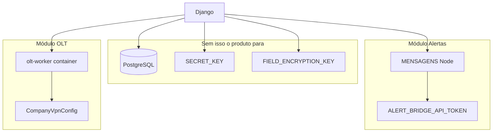

# READINESS — Arquitetura Real (RM Systems)

> **Modo:** READ ONLY — auditoria estática + inspeção de código  
> **Data:** 25/05/2026  
> **Escopo:** arquitetura implementada, não documentação aspiracional

---

## 1. Stack confirmada

| Camada | Evidência |
|--------|-----------|
| Django 5.2 | `README.md`, `docs/DOCUMENTACAO-TECNICA.md` |
| Python 3.12+ | `.github/workflows/tests.yml` |
| PostgreSQL | `saas_viabilidade/settings.py` — `DATABASE_URL` obrigatória |
| Redis opcional | `REDIS_URL` + `USE_REDIS_CACHE` |
| DRF + Spectacular | `INSTALLED_APPS`, `core/api_urls.py` |
| MFA TOTP | `django_otp`, `core/mfa_service.py` |
| Frontend SSR | `templates/`, `static/`, Bootstrap 5, Leaflet |
| E-mail Resend | `core/email/resend_backend.py` |
| Workers | Node (`MENSAGENS/`), Docker (`services/olt_worker/`) |
| Deploy | VPS: `deploy_vps.sh`, `nginx.conf`, `gunicorn.service` |

**Não existe:** Celery, RQ, `docker-compose` raiz, `Procfile`, Render/Heroku config.

---

## 2. Apps Django e responsabilidades

| App | Arquivo config | Função operacional |
|-----|----------------|-------------------|
| `saas_viabilidade` | `saas_viabilidade/apps.py` | Settings, URLs, logging, Sentry, `runserver` custom (sobe bridge) |
| `core` | `core/apps.py` | Tenant, users, mapas, tickets, LGPD, billing, quotas, RM admin, API |
| `ftth_viewer` | `ftth_viewer/apps.py` | Verificador FTTH, geocoding, viabilidade, cache |
| `alerts` | `alerts/apps.py` | Bridge Telegram→WhatsApp, API interna worker |
| `olt_ops` | `olt_ops/apps.py` | OLT Huawei/ZTE, VPN, fila jobs ONU |

---

## 3. Middleware chain (ordem real)

Fonte: `saas_viabilidade/settings.py` L69–92

```
SecurityMiddleware → WhiteNoise → RequestId → CspNonce
→ Session → Common → CrlfProtection → HttpMethodRestriction
→ CsrfView → Auth → OTPMiddleware → MfaEnforcement
→ SessionIdle → SessionRegistry → PasswordChange → Consent
→ SecureCompanyMiddleware → SaasModuleMiddleware
→ GlobalRateLimit → SecurityHeaders → Messages → XFrameOptions
```

**Ordem crítica:**
- Auth **antes** de `SecureCompanyMiddleware` — tenant resolvido com usuário já carregado
- MFA **antes** de tenant — RM/staff exigem TOTP verificado
- `SaasModuleMiddleware` **depois** de tenant — bloqueia módulo desabilitado no plano

---

## 4. Resolução multi-tenant

### Como o tenant é resolvido

`core/middleware_security.py` → `SecureCompanyMiddleware`:

1. Primeiro segmento da URL analisado (`/{slug}/...`)
2. Se `rm`, `api`, `health`, `verificador`, etc. → `request.is_rm_access = True`, `company = None`
3. Se slug corresponde a `Company.slug` ativo → `request.company`, `request.company_slug`
4. Login empresa (`/{slug}/login/`) permitido sem auth; demais rotas empresa exigem auth + match `user.company`

**Modelo:** shared database, coluna `company_id` — **não** schema-per-tenant.

### RBAC

| Role | Capabilities |
|------|--------------|
| `RM` | Acesso `/rm/*`, gestão global, bypass quota (parcial) |
| `COMPANY_ADMIN` | Admin do tenant: usuários, mapas, alertas, OLT |
| `COMPANY_USER` | Operação limitada (verificador, tickets) |

Decorators: `rm_admin_required`, `company_access_required`, `user_management_required` em `core/permissions.py`.

API: `TenantScopedPermission`, `IsCompanyAdminOrRM`, `MfaVerifiedPermission` em `core/api_permissions.py`.

---

## 5. Fluxo de autenticação

```
Login (RM ou /{slug}/login/)
  → rate limit (core/rate_limiting.py)
  → lockout (core/login_lockout.py)
  → authenticate (Argon2)
  → safe_redirect para next (core/safe_redirect.py) — anti open-redirect
  → MFA setup/verify se mfa_required_for(user)
  → must_change_password middleware
  → consent LGPD middleware
  → dashboard
```

**Sessões:** `UserSessionRecord` + `SessionRegistryMiddleware` — concorrência, bind IP, revogação (`core/session_security.py`).

**Ativação:** link único `/ativar-conta/<token>/` — `AccountActivationToken` digest, não plaintext.

---

## 6. MFA

- **Serviço:** `core/mfa_service.py` — `mfa_required_for`, TOTP, trusted device
- **Middleware HTML:** `core/middleware_mfa.py` — exempt: login, MFA routes, health, ativação
- **API DRF:** `MfaVerifiedPermission` global em `REST_FRAMEWORK`
- **Flags:** `MFA_REQUIRED`, `MFA_REQUIRED_COMPANY_ADMINS` em settings

**Gap:** login empresa (`/{slug}/login/`) não está na lista EXEMPT do MFA middleware — MFA aplicado após auth para todos os perfis elegíveis.

---

## 7. Billing — ativação/suspensão de tenant

Modelo: `CompanyBilling` (`core/models.py` L162–229)

| Evento webhook | Método | Efeito |
|----------------|--------|--------|
| `PAYMENT_RECEIVED*` | `apply_payment_received()` | `billing.status=active`, `company.is_active=True` |
| `PAYMENT_OVERDUE` | `apply_payment_overdue()` | `billing.status=past_due` — **não desativa company** |
| `SUBSCRIPTION_*` cancel | `apply_subscription_cancelled()` | `billing.status=cancelled`, `company.is_active=False` |

Webhook: `core/billing/asaas_webhook.py` — `@csrf_exempt`, token header only.

---

## 8. Alert Bridge ↔ Django

```
Node worker (MENSAGENS/src/index-saas.js)
  → poll GET /api/internal/alert-bridge/configs/
  → validate_bridge_request (core/bridge_security.py)
      IP allowlist + X-Bridge-Token + HMAC + nonce anti-replay
  → JSON configs com telegram_token em plaintext (alerts/models.py to_worker_payload)
  → Telegraf polling Telegram
  → Baileys WhatsApp (MENSAGENS/data/whatsapp/{slug}/)
```

**Dev:** `core/alert_bridge_runner.py` sobe Node com `runserver` se `DEBUG` + `RUN_ALERT_BRIDGE=true`.

**Prod:** processo separado (systemd/cron manual) — **não** integrado ao Gunicorn.

**Heartbeat:** `AlertBridgeWorkerStatus.touch()` + `check_bridge_health` command.

---

## 9. Jobs OLT

```
UI olt_ops/views.py
  → dispatch_job (olt_ops/dispatcher.py)
  → host: thread + vpn_slot mutex
  → container: docker run → manage.py olt_run_job
  → company_vpn_context (olt_ops/vpn_manager.py)
  → SSH Huawei/ZTE (olt_ops/olt_session.py)
  → OnuCleanupJob status + log_output
```

**Fila:** `olt_ops/queue.py` — status `queued`, lock `olt:queue:processor` via cache (Redis ou locmem).

**Idempotência fila:** re-enfileira só se mesma operação; update condicional `status=queued`.

---

## 10. Criptografia Fernet

Implementação: `core/field_encryption.py`

- Prefixo: `enc:v1:`
- Chave: `FIELD_ENCRYPTION_KEY` (44 chars url-safe)
- Fallback `SECRET_KEY` derivado: **somente** testes ou `ALLOW_FIELD_ENCRYPTION_SECRET_FALLBACK=true` em DEBUG
- Falha decrypt: retorna `""` + log error (não levanta exceção ao usuário)

**Campos:** CNPJ (`core/models.py`), Telegram token (`alerts/models.py`), OLT/VPN passwords (`olt_ops/models.py`).

---

## 11. Quotas e planos

Definição: `core/plans.py` — P/M/G/XL com módulos e limites.

Enforcement: `core/quotas.py` — `enforce_quota()`, métricas users/maps/viability/whatsapp/olts/jobs.

Middleware: `SaasModuleMiddleware` bloqueia URL de módulo desabilitado.

Flags: `Company.quota_enforcement`, overrides `quota_override_*`, `QUOTA_ENFORCEMENT_ENABLED`.

---

## 12. Pipelines GitHub Actions

| Workflow | Arquivo | Ações |
|----------|---------|-------|
| Tests | `.github/workflows/tests.yml` | Django tests, SQLite CI |
| Security | `.github/workflows/security.yml` | `check --deploy`, `check_security --strict`, pip-audit, Bandit, `scripts/security-check.sh` |

**Sem pipeline de deploy** para VPS.

---

## 13. Scripts operacionais

| Script | Função |
|--------|--------|
| `deploy_vps.sh` | Deploy manual |
| `backup-db.sh` | Backup PG + GPG |
| `scripts/cron-lgpd-*.sh` | LGPD purge |
| `scripts/cron-purge-caches.sh` | Cache geocoding |
| `scripts/security-check.sh` | Scan padrões secretos |
| `scripts/build-olt-worker.sh` | Build imagem OLT |

---

## 14. Diagrama de dependências críticas



---

## 15. Pontos críticos arquiteturais

1. **Monólito + workers externos** — falha Node/Docker não derruba Django, mas módulos ficam mortos silenciosamente.
2. **Cache como lock distribuído** — sem Redis, locks OLT/bridge nonce não funcionam entre workers Gunicorn.
3. **Bridge devolve secrets** — token Telegram plaintext no JSON de configs.
4. **Billing parcial** — inadimplência não suspende tenant automaticamente.
5. **Settings único** — `settings_production.py` deprecado; tudo via env + `security_bootstrap.py`.

---

*Auditoria read-only. Nenhum código alterado.*
