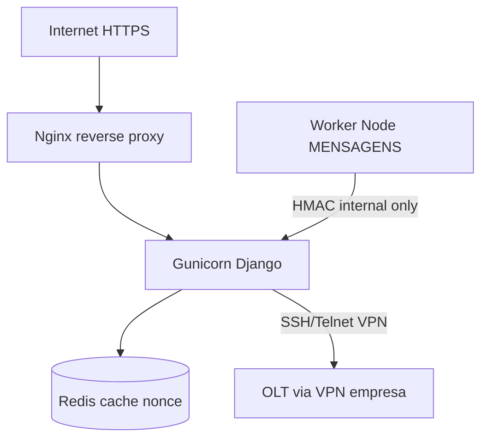

# Segmentação de rede — OLT, Alert Bridge e SaaS

## Visão geral



- **Público:** apenas `443` → Nginx → Django (`/`, `/rm/`, APIs autenticadas).
- **Interno:** `/api/internal/alert-bridge/` só de IPs allowlist (`ALERT_BRIDGE_ALLOWED_IPS`).
- **OLT:** tráfego só após túnel VPN da empresa; sem exposição de credenciais em logs.
- **OLT multi-tenant (VPN):** em produção com vários ISPs, use `OLT_EXECUTION_MODE=container` — ver [OLT_WORKER.md](OLT_WORKER.md).

---

## Nginx (produção)

Arquivo de referência: `docs/deploy/nginx-alert-bridge.conf.example`

Pontos críticos:

1. `proxy_set_header X-Forwarded-Proto https;`
2. Bloquear `/api/internal/` na internet; permitir só rede Docker/host bridge.
3. Não servir `/media/` como `alias` público.
4. Rate limit em login e APIs.
5. `server_tokens off;` e ocultar versão no upstream (complementa `HIDE_SERVER_HEADER` no Django).
6. Bloquear métodos perigosos no edge:
   ```nginx
   if ($request_method ~ ^(TRACE|CONNECT)$) { return 405; }
   ```

---

## Firewall (UFW — VPS Linux)

```bash
# Padrão deny
ufw default deny incoming
ufw default allow outgoing

# SSH administrativo (ajuste IP admin)
ufw allow from SEU_IP_ADMIN to any port 22 proto tcp

# HTTPS público
ufw allow 80/tcp
ufw allow 443/tcp

# Redis e Gunicorn — apenas localhost
# (não abrir 6379/8000 na internet)

ufw enable
```

**Proibido na internet:** `8000` (Gunicorn), `6379` (Redis), `3921` (WhatsApp bridge local), portas OLT `22/23`.

---

## Docker / rede interna (sugestão)

```yaml
# docker-compose excerpt
services:
  web:
    networks: [saas_front, saas_internal]
    expose: ["8000"]
  redis:
    networks: [saas_internal]
  alert_bridge:
    networks: [saas_internal]
    environment:
      ALERT_BRIDGE_API_URL: http://web:8000/api/internal/alert-bridge/configs/
      ALERT_BRIDGE_ALLOWED_IPS: 172.28.0.0/16  # rede bridge Docker
```

- Rede `saas_internal`: sem rota para internet.
- Worker Node só enxerga Django na rede interna.
- Defina `ALERT_BRIDGE_TRUSTED_PROXIES` com IP do container Nginx.

---

## Bridge isolada

| Controle | Variável |
|----------|----------|
| IP allowlist | `ALERT_BRIDGE_ALLOWED_IPS` |
| HMAC dedicado | `BRIDGE_HMAC_SECRET` ≠ `ALERT_BRIDGE_API_TOKEN` |
| Anti-replay | `REDIS_URL` + `BRIDGE_NONCE_TTL_SEC` |
| Timestamp | `BRIDGE_SIGNATURE_MAX_AGE_SEC=120` |
| Proxy confiável | `ALERT_BRIDGE_TRUSTED_PROXIES` |

Rotação: `python manage.py rotate_bridge_credentials`

---

## Cron — purge logs OLT

```cron
0 3 * * * cd /var/www/saas-viabilidade && /venv/bin/python manage.py purge_olt_logs --days=7 >> /var/log/saas/purge_olt.log 2>&1
```
