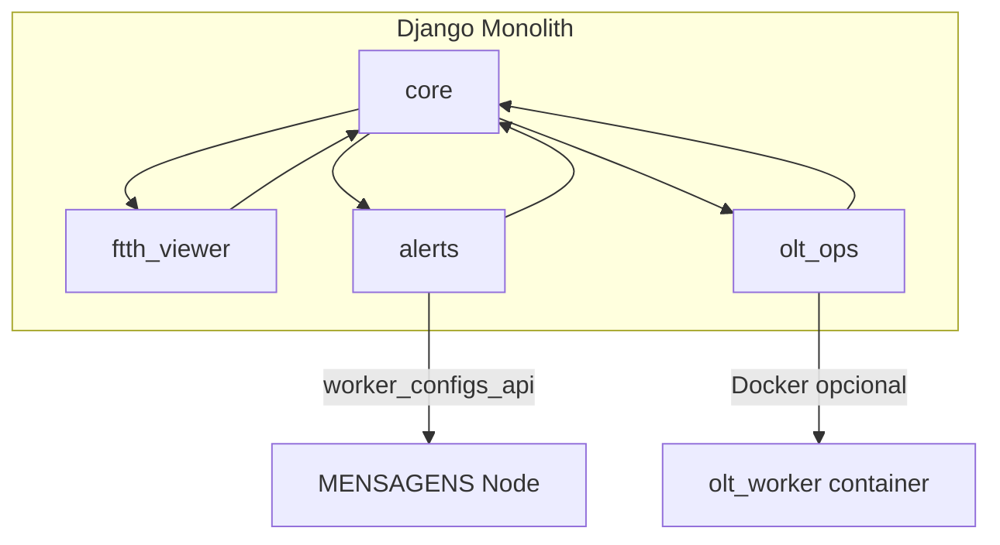

# RM Systems — Estudo completo do repositório (arquivo a arquivo)

| Campo | Valor |
|-------|--------|
| **Data** | 23 de maio de 2026 |
| **Tipo** | Inventário técnico read-only |
| **Escopo** | Código-fonte, templates, static, docs, workers, CI — **exclui** `node_modules/`, `staticfiles/`, `__pycache__/`, `media/`, `logs/`, `Mapas/` |

---

## 1. Visão macro

### 1.1 Contagem por área (arquivos significativos)

| Área | ~Arquivos | Papel |
|------|-----------|--------|
| `core/` | 141 | Domínio SaaS: tenant, auth, LGPD, billing, API, tickets |
| `templates/` | 87 | UI Django (RM, empresa, OLT, alertas, legal) |
| `static/` | 62 | CSS design system, JS FTTH, PWA, dom-safe |
| `olt_ops/` | 42 | OLT/ONU, VPN, fila de jobs, worker Docker |
| `ftth_viewer/` | 21 | Verificador FTTH, geocoding, viabilidade |
| `saas_viabilidade/` | 17 | Settings, URLs raiz, bootstrap segurança |
| `alerts/` | 19 | Bridge Telegram→WhatsApp |
| `MENSAGENS/src/` | 14 | Worker Node Baileys (código próprio) |
| `docs/` | 23 | Deploy, LGPD, comercial, interno |
| `scripts/` | 8 | Cron LGPD, segurança, BIMI, OLT worker |
| `services/` | 8 | Alert bridge + OLT worker |
| `archive/` | 12 | Ferramentas desktop legadas (Venda) |

### 1.2 Stack confirmada

- **Django 5** monólito multi-tenant (`/<slug>/`)
- **PostgreSQL** obrigatório (`DATABASE_URL`)
- **DRF** + **drf-spectacular** (OpenAPI `/api/v1/docs/`)
- **django-otp** (MFA TOTP)
- **Redis** opcional (cache, rate limit, bridge nonce)
- **Gunicorn** + **WhiteNoise** + **Nginx**
- **Node** (Baileys) em `MENSAGENS/` e `services/alert_bridge/`
- **Docker** parcial: `services/olt_worker/Dockerfile` apenas

### 1.3 Estado atual vs. auditoria anterior

| Capacidade | Status |
|------------|--------|
| Planos P/M/G/XL no código | ✅ `core/plans.py`, `Company.plan_code` |
| Enforcement de quotas | ✅ `core/quotas.py` |
| Billing Asaas | 🟡 `CompanyBilling`, `core/billing/asaas_webhook.py` |
| API tenant-safe | ✅ `core/api_permissions.py`, testes |
| OpenAPI | ✅ `drf-spectacular` em `api_urls.py` |
| Bridge token em claro na API | ❌ Ainda em `to_worker_payload()` |
| Docker compose full stack | ❌ |

---

## 2. Raiz do repositório

| Arquivo | Função |
|---------|--------|
| `manage.py` | Entrypoint Django |
| `requirements.txt` | Dependências Python (Django, DRF, argon2, paramiko, spectacular, etc.) |
| `README.md` | Instalação, módulos, deploy VPS |
| `VALORES-EMPRESAS.md` | Pricing comercial v2 (espelha `docs/PRECOS-RM-SYSTEMS.md`) |
| `nginx.conf` | Exemplo Nginx (revisar: mídia deve proxy para Django) |
| `gunicorn_config.py` | Workers Gunicorn produção |
| `deploy_vps.sh` | Deploy automatizado Hostinger |
| `setup_vps.sh` / `setup-env.sh` | Bootstrap VPS e `.env` |
| `backup-db.sh` | Backup PostgreSQL |
| `.env.example` | Variáveis documentadas |
| `.gitattributes` | Line endings (Windows/Linux) |
| `.gitignore` | Exclui `.env`, `media/`, `logs/`, `staticfiles/` |

---

## 3. Pacote `saas_viabilidade/` (projeto Django)

| Arquivo | Função |
|---------|--------|
| `__init__.py` | Pacote |
| `apps.py` | `SaasViabilidadeConfig` — runserver customizado sobe bridge |
| `settings.py` | Config principal: middleware, DRF, LGPD, quotas, Redis |
| `settings_production.py` | Legado — **divergente** do `settings.py`; evitar em prod |
| `urls.py` | Rotas globais: health, API, LGPD, RM, verificador, catch-all |
| `wsgi.py` / `asgi.py` | WSGI/ASGI |
| `security_bootstrap.py` | Fail-fast: DEBUG, SECRET_KEY, SSL, mídia protegida |
| `env_loader.py` | Carrega `.env` + `.env.local` (override) |
| `env_validation.py` | Validação estrita em produção |
| `logging_config.py` | Logs sanitizados, JSON opcional, audit/security files |
| `sentry_bootstrap.py` | Sentry opcional, `send_default_pii=False` |
| `management/commands/runserver.py` | Dev: sobe worker alertas com Django |
| `management/commands/check_bridge_health.py` | Health do bridge Node |

---

## 4. App `core/` — núcleo do SaaS

### 4.1 Modelos e domínio

| Arquivo | Função |
|---------|--------|
| `models.py` | `Company` (planos, quotas, módulos), `CustomUser`, `CTOMapFile`, tickets, LGPD, MFA, sessões, `CompanyBilling` |
| `encrypted_fields.py` | `EncryptedCharField` (Fernet) |
| `cnpj_utils.py` | Formato, hash, máscara CNPJ |
| `plans.py` | `PlanLimits` P/M/G/XL — limites comerciais |
| `quotas.py` | Metering, `enforce_quota`, `get_usage_summary`, avisos % |
| `modules.py` | Helpers módulos por empresa |
| `lgpd_constants.py` | Versão documentos legais, tipos consentimento |

### 4.2 API REST

| Arquivo | Função |
|---------|--------|
| `api.py` | ViewSets Company/Maps/Users com tenant + quotas |
| `api_urls.py` | Router DRF + Swagger `/api/v1/docs/` |
| `api_permissions.py` | `TenantScopedPermission` object-level |
| `serializers.py` | Serializers sem password; CNPJ mascarado |
| `permissions.py` | Decorators RM/empresa; `company_access_required` |

### 4.3 Autenticação e sessão

| Arquivo | Função |
|---------|--------|
| `views.py` | Dashboards RM/empresa, CRUD empresas/usuários/mapas, docs legais |
| `urls_rm.py` | Rotas `/rm/*` |
| `urls_company.py` | Rotas `/<slug>/*` |
| `password_reset.py` | Reset senha multi-tenant |
| `activation_views.py` | Ativação conta por token |
| `account_activation.py` | Tokens digest, e-mail mascarado |
| `mfa_views.py` / `mfa_service.py` | Setup/verify/recovery MFA |
| `mfa_lockout.py` | Lockout progressivo TOTP |
| `login_lockout.py` | Lockout login |
| `session_views.py` | Gestão sessões ativas |
| `session_security.py` | Helpers sessão |
| `signals_session_security.py` | Registro/revogação sessão |
| `signals_single_session.py` | Sessão única (opcional) |

### 4.4 LGPD

| Arquivo | Função |
|---------|--------|
| `lgpd_views.py` | Consentimento, portal titular, export, delete |
| `lgpd_export.py` | ZIP assinado, payload JSON/CSV |
| `lgpd_anonymization.py` | Anonimização conta e tickets |
| `lgpd_retention.py` | Políticas de retenção |
| `middleware_consent.py` | Exige aceite legal (com isenções API) |

### 4.5 Segurança

| Arquivo | Função |
|---------|--------|
| `middleware_security.py` | `SecureCompanyMiddleware` — tenant por slug |
| `middleware_modules.py` | Bloqueia módulo desabilitado |
| `middleware_mfa.py` | Enforcement MFA |
| `middleware_csp.py` | Nonce CSP |
| `middleware_rate_limit_global.py` | Rate limit global |
| `middleware_request_id.py` | Request ID correlação |
| `middleware_session_idle.py` | Timeout inatividade |
| `middleware_session_registry.py` | Registry sessões |
| `middleware_password_change.py` | Força troca senha |
| `security_headers.py` | CSP, HSTS headers |
| `bridge_security.py` | HMAC bridge, IP allowlist, nonce |
| `media_protected.py` | Mídia autenticada + URLs assinadas |
| `upload_security.py` | Upload seguro, ClamAV opcional, quarentena |
| `security_validators.py` | Validação conteúdo upload |
| `validators.py` | Senha complexa |
| `throttling.py` | Throttles DRF |
| `rate_limiting.py` | Rate limit login/upload |
| `log_sanitizer.py` | Mascara PII em logs |
| `operational_sanitizer.py` | Sanitiza logs OLT/SSH |
| `audit_trail.py` / `audit_logger.py` | Eventos segurança |
| `health_views.py` | `/health/`, `/ready/`, `/health/security/` |
| `error_views.py` | 400/403/404/500 customizados |

### 4.6 Billing (parcial)

| Arquivo | Função |
|---------|--------|
| `billing/__init__.py` | Pacote billing |
| `billing/asaas_webhook.py` | Webhook Asaas → `CompanyBilling` |

### 4.7 E-mail e bridge

| Arquivo | Função |
|---------|--------|
| `email/send_transactional.py` | Envio transacional |
| `email/resend_backend.py` | Backend Resend opcional |
| `email_branding.py` | Branding e-mails |
| `alert_bridge_runner.py` | Sobe processo Node MENSAGENS |
| `bimi_views.py` | BIMI (e-mail branding) |

### 4.8 Tickets e notificações

| Arquivo | Função |
|---------|--------|
| `ticket_views.py` | CRUD tickets RM/empresa |
| `ticket_signals.py` | Signals tickets |
| `notification_views.py` | Notificações in-app |

### 4.9 Admin e forms

| Arquivo | Função |
|---------|--------|
| `admin.py` | Admin RM custom (`rm_admin_site`) |
| `forms.py` | Forms empresa, usuário, tickets |
| `reports.py` | Relatórios RM |
| `verificador_service.py` | Integração serviço mapas |

### 4.10 Management commands

| Comando | Função |
|---------|--------|
| `check_security` | Auditoria SECRET_KEY, gera chave |
| `check_deploy` | Checks deploy |
| `scan_security` | Scan padrões inseguros |
| `setup_p1/p2/p3_security` | Hardening fases |
| `rotate_bridge_credentials` | Rotação token/HMAC bridge |
| `process_data_subject_requests` | Cron exclusão LGPD |
| `purge_lgpd_retention` | Purge retenção |
| `purge_old_caches` | Cache FTTH antigo |
| `purge_activation_tokens` | Tokens expirados |
| `lgpd_compliance_report` | Relatório conformidade |
| `lgpd_data_inventory` | Inventário dados |
| `onboarding_checklist` | Checklist implantação |
| `clear_rate_limit` / `clear_tickets` | Utilitários |
| `debug_login` | Debug (só DEBUG) |
| `reset_superuser` / `normalize_superusers` | Ops usuários |
| `test_resend_email` | Teste e-mail |

### 4.11 Testes `core/`

| Arquivo | Cobertura |
|---------|-----------|
| `tests_api_tenant.py` | API cross-tenant |
| `tests_quotas.py` | Enforcement quotas |
| `tests_lgpd_enterprise.py` | LGPD enterprise |
| `tests_phase2/3/4_security.py` | Fases segurança |
| `tests_operational_hardening.py` | Bridge, ops |
| `tests_activation.py` | Ativação conta |
| `tests.py` | Geral |
| `test_helpers.py` | Helpers teste |

### 4.12 Migrations `core/` (evolução)

| Migração | Marco |
|----------|-------|
| `0001`–`0003` | Company, User, slug |
| `0006` | Integração Flask/mapas |
| `0007`–`0013` | Tickets, notificações |
| `0012` | Módulos SaaS flags |
| `0014`–`0021` | LGPD, consent, DSR, export |
| `0018` | CNPJ criptografado + hash |
| `0019`–`0022` | Security audit enterprise |
| `0024` | `plan_code` + quota overrides |
| `0025` | `CompanyBilling` |

### 4.13 Templates `core/templates/`

| Template | Função |
|----------|--------|
| `rm_dashboard.html` | Dashboard RM |
| `rm_companies.html` / `rm_company_portal.html` | Gestão empresas |
| `rm_tenant_usage.html` | Uso por tenant (quotas) |
| `company_dashboard.html` / `company_hub.html` | Painel empresa |
| `upload_page.html` | Upload mapas |

---

## 5. App `ftth_viewer/` — Verificador FTTH

| Arquivo | Função |
|---------|--------|
| `models.py` | `GeocodingCache` (hash), `ViabilidadeCache`, `CTOFile` legado |
| `views.py` | UI mapa + APIs: arquivos, coordenadas, geocode, viabilidade |
| `urls.py` | Rotas verificador global e por empresa |
| `utils.py` | Leitura KML/KMZ/CSV/XLS, rotas OSRM, cache |
| `geocoding_privacy.py` | Hash endereço, TTL, purge |
| `admin.py` | Admin Django |
| `management/commands/purge_geocoding_cache.py` | Limpeza cache |
| `tests_geocoding_cache.py` | Testes privacidade cache |
| `templates/ftth_viewer/index.html` | Página mapa principal |
| `migrations/0001`–`0007` | Evolução cache privacidade + `mapas_hash` |

**APIs principais (todas `@login_required`):**

- `api_arquivos` — lista mapas CTO do tenant
- `api_coordenadas` — pontos do mapa
- `api_geocode` / `api_geocode_suggestions` — Nominatim
- `api_verificar_viabilidade` — cálculo + cache
- `api_adicionar_cto` / `api_remover_cto` — edição mapa

---

## 6. App `alerts/` — Alertas

| Arquivo | Função |
|---------|--------|
| `models.py` | `AlertBridgeConfig`, `WhatsAppLine`; `to_worker_payload()` |
| `views.py` | Settings UI, QR/pareamento, **`worker_configs_api`** (interno) |
| `forms.py` | Forms config e linhas |
| `whatsapp_client.py` | HTTP para worker local :3921 |
| `urls.py` | Rotas `/<slug>/alertas/` |
| `admin.py` | Admin |
| `tests_permissions.py` | Permissões módulo |
| `migrations/0001`–`0009` | Evolução filtros, encrypt token, worker status |

**Risco conhecido:** `worker_configs_api` ainda serializa `telegram_token` em claro para o worker Node.

---

## 7. App `olt_ops/` — OLT / ONU

| Arquivo | Função |
|---------|--------|
| `models.py` | `OltEquipment`, `CompanyVpnConfig`, jobs, fila |
| `views.py` | UI OLT, VPN, jobs, status JSON |
| `urls.py` | `/<slug>/olt/` |
| `olt_service.py` | Orquestração operações |
| `olt_session.py` | Sessão SSH/telnet |
| `job_runner.py` | Runner jobs legado |
| `job_workers.py` | Workers paralelos |
| `dispatcher.py` | Host vs container Docker |
| `execution.py` | Execução comandos |
| `queue.py` | Fila jobs ONU |
| `vpn_manager.py` | OpenVPN / L2TP no host |
| `vpn_slot.py` | Mutex VPN (1 por vez) |
| `huawei_cli.py` / `zte_cli.py` | CLIs vendor |
| `huawei_delete.py` | Exclusão ONU Huawei |
| `gpon_parse.py` | Parse saída GPON |
| `operational_log.py` | Log sanitizado |
| `cli_log.py` | Log CLI |
| `forms.py` | Forms OLT/VPN |
| `user_messages.py` | Mensagens UX |
| `management/commands/olt_run_job.py` | CLI job |
| `management/commands/olt_vpn_test.py` | Teste VPN |
| `management/commands/purge_olt_logs.py` | Retenção logs |
| `tests_*.py` | dispatcher, queue, vpn_slot, execution |
| `migrations/0001`–`0009` | VPN, encrypt, execution config, **job queue** |

---

## 8. Workers e serviços externos

### 8.1 `MENSAGENS/src/` (código próprio — ignorar `node_modules/`)

| Arquivo | Função |
|---------|--------|
| `index-saas.js` | Entry worker multi-tenant SaaS |
| `load-from-api.js` | Busca configs Django (`worker_configs_api`) |
| `config.js` | Env Telegram/WhatsApp |
| `telegram.js` | Cliente Telegraf |
| `whatsapp.js` / `whatsapp-saas.js` | Baileys multi-linha |
| `whatsapp-api.js` | API HTTP local QR/status |
| `filters.js` / `filters-saas.js` | Filtros mensagens |
| `antiban.js` / `antiban-saas.js` | Delays antiban |
| `list-whatsapp-groups.js` | Utilitário grupos |

### 8.2 `services/alert_bridge/`

| Arquivo | Função |
|---------|--------|
| `src/bridge-auth.js` | Auth HMAC para API Django |
| `src/load-configs.js` | Fetch configs |
| `src/filters.js` | Filtros |
| `package.json` | Deps Node |
| `README.md` | Doc bridge alternativo |

### 8.3 `services/olt_worker/`

| Arquivo | Função |
|---------|--------|
| `Dockerfile` | Imagem worker OLT |
| `README.md` | Doc execução container |

---

## 9. Templates globais `templates/` (87 arquivos)

### 9.1 Base e layout

| Arquivo | Função |
|---------|--------|
| `base.html` | Layout principal + sidebar módulos |
| `base_minimal.html` | Layout mínimo (auth) |
| `docs_base.html` | Layout documentação |
| `dashboard.html` | Dashboard legado/global |
| `login.html` | Login genérico |

### 9.2 Includes reutilizáveis

| Arquivo | Função |
|---------|--------|
| `includes/saas_sidebar_modules.html` | Menu módulos por plano |
| `includes/quota_usage.html` | Barra uso do plano |
| `includes/ux_alert.html` | Alertas UX |
| `includes/module_url.html` | URLs módulos |
| `includes/auth_*` | Footer/login mobile |

### 9.3 RM (`templates/rm/`)

Empresas, usuários, mapas, tickets, relatórios, password reset.

### 9.4 Empresa (`templates/company/`)

Login, mapas, usuários, tickets, reports, password reset.

### 9.5 OLT (`templates/olt_ops/`)

Home, lista/form OLT, VPN, jobs (form, detail, live).

### 9.6 Core/Legal (`templates/core/`, `templates/legal/`)

MFA, consent, LGPD portal, DPO, ativação conta, e-mails transacionais.

### 9.7 Erros (`templates/errors/`)

400, 403, 404, 500, generic.

---

## 10. Static `static/`

| Pasta/arquivo | Função |
|---------------|--------|
| `css/design-system.css` | Design system RM (tokens, cards, DS) |
| `css/platform.css` / `global.css` | Layout plataforma |
| `css/verificador.css` | Estilos mapa FTTH |
| `js/dom-safe.js` | Helpers XSS-safe (substitui innerHTML) |
| `js/global-loading.js` | Overlay loading |
| `js/dark-mode.js` | Tema claro/escuro |
| `js/ticket-detail.js` | Chat tickets |
| `js/olt-live.js` | Job OLT ao vivo |
| `js/pwa.js` / `sw.js` | PWA service worker |
| `ftth_viewer/js/app.js` | **App principal mapa** (~3000 linhas) |
| `ftth_viewer/style.css` | Estilos viewer |
| `well-known/bimi/` | Ícones BIMI e-mail |

---

## 11. Documentação `docs/`

| Arquivo | Função |
|---------|--------|
| `README.md` | Índice docs |
| `DOCUMENTACAO-TECNICA.md` | Doc técnica geral |
| `PLATAFORMA-UNIFICADA.md` | Unificação 3 módulos |
| `PRECOS-RM-SYSTEMS.md` | Pricing oficial |
| `ROPA.md` / `SUBOPERADORES-LGPD.md` | Compliance |
| `LGPD_IMPACT_REPORT.md` | Impacto LGPD |
| `SECURITY_HARDENING_REPORT.md` | Hardening |
| `BIMI_SETUP.md` | Config BIMI |
| `deploy/DEPLOY.md` | Deploy VPS |
| `deploy/NETWORK_HARDENING.md` | Rede |
| `deploy/nginx-alert-bridge.conf.example` | Nginx seguro |
| `deploy/OLT_WORKER.md` | Worker OLT Docker |
| `deploy/ROTACAO_SECRETS.md` | Rotação secrets |
| `commercial/OLT_ESCOPO_SUPORTE.md` | Escopo suporte OLT |
| `commercial/WHATSAPP_CONTINGENCIA.md` | Risco WhatsApp |
| `internal/BUSINESS_ANALYSIS_REPORT.md` | Análise negócio |
| `internal/MELHORIAS_A_FAZER.md` | Backlog priorizado |
| `internal/RELATORIO_FINAL_LGPD_SECURITY.md` | Auditoria LGPD |
| `internal/PROJECT_STUDY.md` | Este documento |

---

## 12. CI/CD e scripts

### 12.1 `.github/workflows/`

| Workflow | Função |
|----------|--------|
| `security.yml` | check --deploy, pip-audit, bandit, secret scan |
| `tests.yml` | Testes Django automatizados |

### 12.2 `scripts/`

| Script | Função |
|--------|--------|
| `security-check.sh` | Padrões secrets no repo |
| `security-audit.sh` | Auditoria adicional |
| `cron-lgpd-retention.sh` | Cron purge LGPD |
| `cron-lgpd-delete.sh` | Cron DSR delete |
| `cron-purge-caches.sh` | Cron caches FTTH |
| `build-olt-worker.sh` | Build imagem OLT |
| `generate_bimi_logo.py` | Gera assets BIMI |

---

## 13. Arquivo legado `archive/legacy-desktop-tools/`

Ferramentas desktop pré-SaaS (deletar ONU, listar ONT, compilar Venda). **Não fazem parte do runtime web** — referência histórica e scripts locais Windows.

---

## 14. Mapa de dependências entre apps

---

## 15. Rotas HTTP principais (mapa mental)

| Prefixo | App | Auth |
|---------|-----|------|
| `/rm/` | core | RM admin |
| `/<slug>/` | core + includes | Empresa |
| `/<slug>/verificador/` | ftth_viewer | Login |
| `/<slug>/alertas/` | alerts | Admin empresa |
| `/<slug>/olt/` | olt_ops | Admin empresa |
| `/verificador/` | ftth_viewer | Login global |
| `/api/v1/` | core DRF | Session |
| `/api/internal/alert-bridge/` | alerts | HMAC+IP |
| `/meus-dados/` | core LGPD | Login |
| `/health/` | core | Público |

---

## 16. Gaps ainda abertos (para o roadmap)

| ID | Gap | Onde |
|----|-----|------|
| G1 | Token Telegram em API bridge | `alerts/models.py:112` |
| G2 | Billing Asaas incompleto (suspensão automática) | `billing/asaas_webhook.py` |
| G3 | Metering mensagens alerta / jobs OLT mensais | Parcial em quotas |
| G4 | SSO / white-label | Ausente |
| G5 | Docker compose stack completo | Só OLT worker |
| G6 | Celery para jobs pesados | Ausente |
| G7 | OLT agent on-prem | `services/olt_worker` parcial |

---

## 17. Como navegar o código (onboarding dev)

1. Comece por `saas_viabilidade/urls.py` → rotas globais.
2. Leia `core/models.py` (Company + planos) e `core/permissions.py`.
3. Fluxo empresa: `core/urls_company.py` → views em `core/views.py`.
4. FTTH: `ftth_viewer/views.py` + `static/ftth_viewer/js/app.js`.
5. Segurança: `security_bootstrap.py` + middlewares `core/middleware_*.py`.
6. Quotas: `plans.py` → `quotas.py` → uso em `api.py` e forms.
7. Testes: `tests_api_tenant.py`, `tests_quotas.py`.

---

## 18. Conclusão do estudo

O repositório é um **monólito Django maduro** com **~470 arquivos fonte** (excl. vendor), organizado por domínio de negócio ISP. A evolução recente (planos, quotas, API tenant, OpenAPI, OLT worker, Sentry) aproxima o produto de **SaaS comercial**, mas **bridge secrets**, **billing completo** e **infra containerizada** permanecem como próximos marcos.

**Próximo documento de execução:** `docs/internal/MELHORIAS_A_FAZER.md` (backlog P0–P3 já priorizado).

---

*Gerado por varredura automatizada + leitura de módulos críticos. Nenhum arquivo de aplicação foi modificado.*
