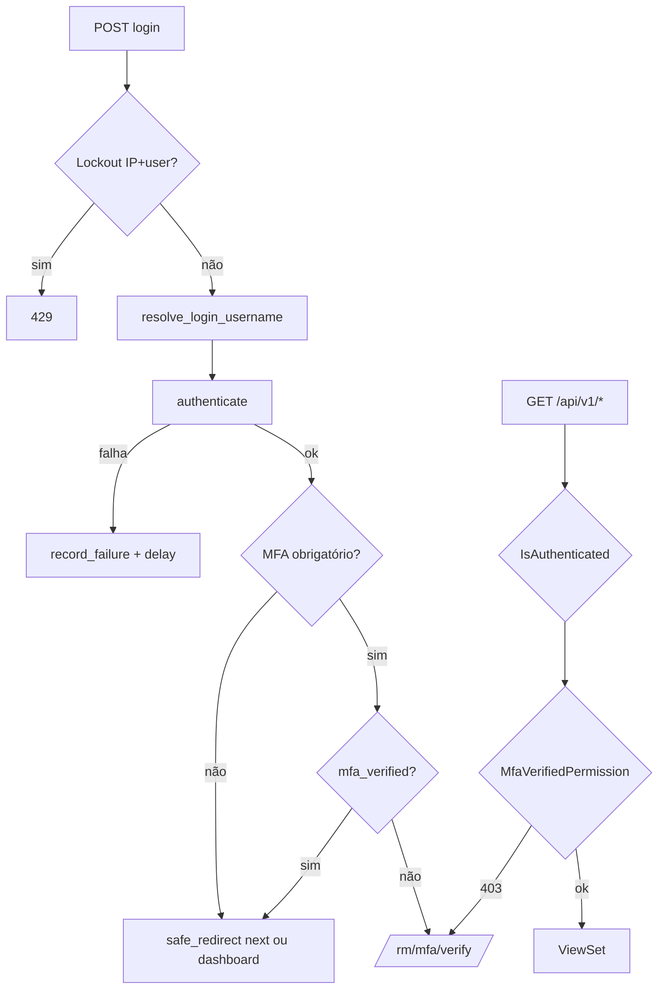

# Etapa 2 — Autenticação e login

## Vulnerabilidades corrigidas

| ID | Problema | Correção |
|----|----------|----------|
| CRITICAL-02 | Open redirect (`next`) no login RM | `core/safe_redirect.py` + validação `url_has_allowed_host_and_scheme` |
| HIGH-03 | Spoofing `X-Forwarded-For` | `core/request_ip.py` — XFF só com proxy confiável |
| HIGH-01 | MFA bypass na API `/api/v1/` | Removido exempt no middleware + `MfaVerifiedPermission` no DRF |
| MEDIUM | Enumeração por e-mail / timing | `resolve_login_username` + `apply_login_failure_delay` |
| — | MFA verify redirect inseguro | `safe_redirect` no `mfa_verify` |

## Fluxo de autenticação (atualizado)

## Endpoints protegidos por MFA

Quando `MFA_REQUIRED=True` (e usuário RM/staff/superuser, ou `MFA_REQUIRED_COMPANY_ADMINS` para admins):

| Área | Proteção |
|------|----------|
| Views HTML (exceto exempt) | `MfaEnforcementMiddleware` |
| `/api/v1/*` | `MfaVerifiedPermission` (DRF) |
| Isentos | `/rm/login/`, `/rm/logout/`, `/rm/mfa/*`, `/rm/sessoes/`, `/ativar-conta/`, `/health/`, `/ready/`, estáticos |

## IP confiável

- Variável: `TRUSTED_PROXY_IPS` ou `ALERT_BRIDGE_TRUSTED_PROXIES` (padrão `127.0.0.1,::1`)
- Usado em: lockout, sessão, MFA lockout, rate limit, bridge, ativação de conta

## Cookies e sessão

Sem alteração de flags de cookie nesta etapa (`SESSION_COOKIE_*`, `CSRF_*` permanecem da Etapa 1 / settings).

---

*Etapa 3 (autorização multi-tenant) aguarda aprovação.*
